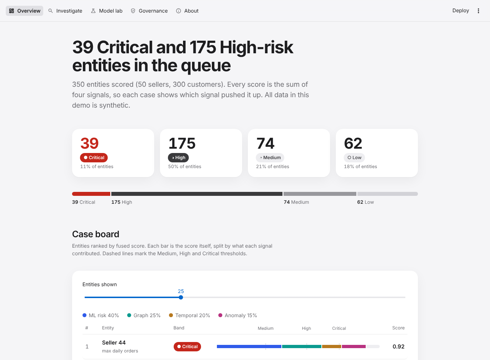
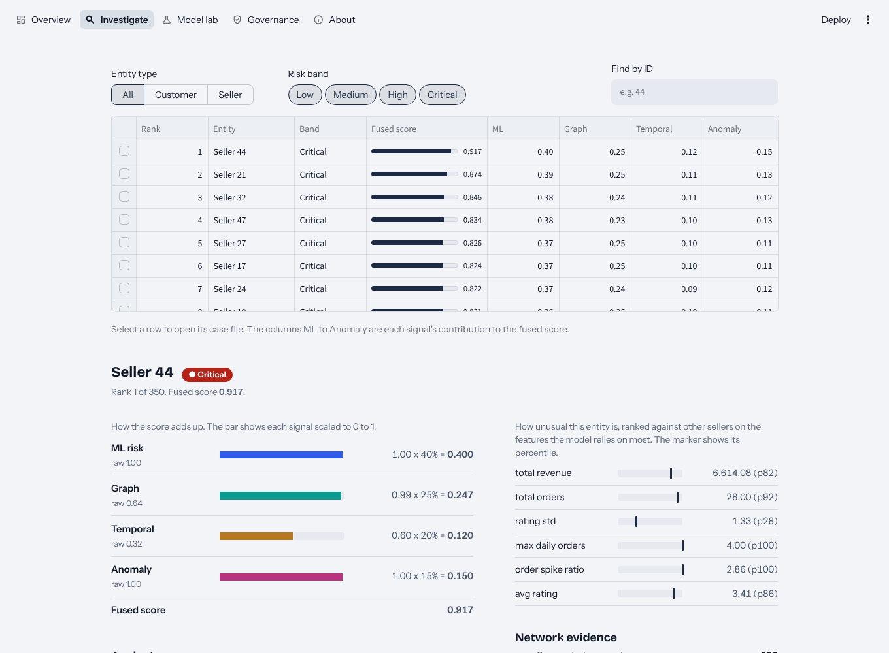
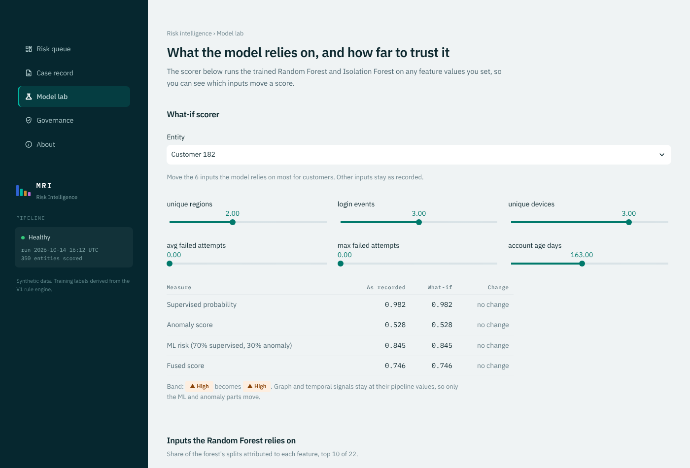
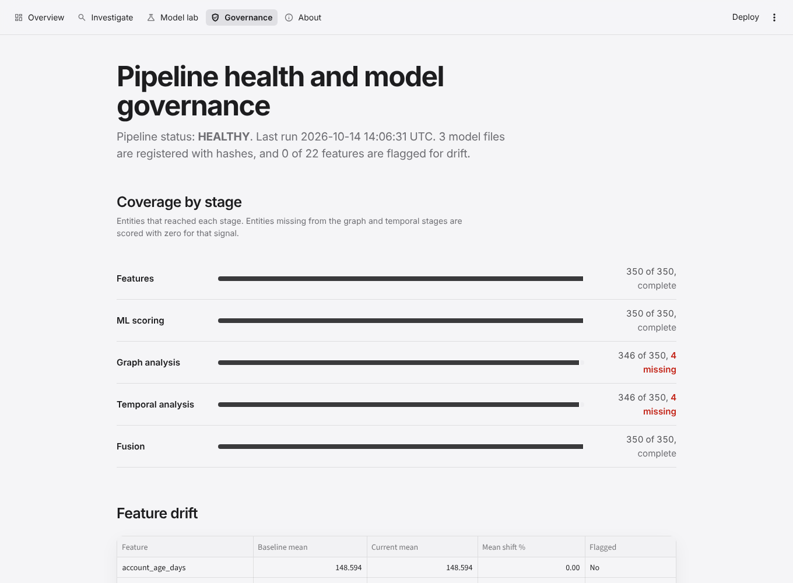

# MRI — Marketplace Risk Intelligence

Multi-signal fraud and risk scoring for online marketplaces. Four independent
detectors — a rule engine, supervised ML, unsupervised anomaly detection, graph
analysis and temporal burst detection — are fused into one explainable score and
surfaced in an analyst workspace with drift monitoring and a model registry.

**[Live demo](https://mri-risk-intelligence.streamlit.app/)** · about 30 s to wake if idle · builds its own dataset on first launch

> Built and tested on **synthetic** marketplace data. This is a reference
> implementation of an architecture, not a detector with measured real-world
> performance. [What it does not prove](#what-this-does-not-prove) is part of the
> project, not a footnote.

| | |
|---|---|
|  |  |
| **Risk queue** — band mix and the case board, every score split into its four contributions | **Case record** — the additive breakdown, peer percentiles and network evidence |
|  |  |
| **Model lab** — what-if scoring against the trained models, and feature importance | **Governance** — stage coverage, feature drift, SHA-256 model registry |

---

## What this demonstrates

- **Signal fusion with a defensible audit trail.** Four detectors, each normalised
  and weighted, combined so that every final score decomposes back into the
  contributions that produced it. No score in the UI is unexplainable.
- **Graph and temporal detection**, not just a tabular classifier: shared-device and
  shared-region clustering with NetworkX, and burst detection over login, order and
  refund windows.
- **MLOps hygiene** as a first-class stage: feature drift against a stored baseline,
  a pipeline health report, and a model registry recording size and SHA-256 per
  artefact so a changed file is detectable.
- **Security engineering applied to the app itself** — parameterised SQL throughout,
  a single-`SELECT` guard on the query helpers, HTML escaping on every interpolated
  value, and errors that never leak a traceback. See [SECURITY.md](SECURITY.md).
- **Honest evaluation.** The headline metrics are perfect, and the project explains
  at length why that is a red flag rather than a result.

## Results from the committed dataset

One pipeline run over 350 entities (50 sellers, 300 customers), 22 features:

| | |
|---|---|
| Risk bands | 39 Critical · 175 High · 74 Medium · 62 Low |
| Weak labels from the V1 rules | 288 flagged, 62 not |
| Model metrics (precision / recall / F1 / ROC AUC) | 1.00 — see the caveat below |
| Top three features by split importance | unique regions 0.226, login events 0.219, unique devices 0.189 (63% combined) |
| Stage coverage | features 350/350, ML 350/350, graph 346/350, temporal 346/350, fusion 350/350 |
| End-to-end runtime | about 15 s on a laptop |

## Architecture

```text
Raw CSVs (customers, sellers, orders, refunds, ratings, logins)   data/raw/
        |
        v
SQLite hydration  ->  feature engineering (22 entity-level features)
        |
        v
Detection layer
  V1  Rule engine        heuristic flags, and the weak labels the model trains on
  V2  Supervised model   Random Forest classifier
  V2  Anomaly model      Isolation Forest
  V3  Graph analysis     NetworkX: shared devices, regions, transaction links
  V4  Temporal analysis  login, order and refund bursts in short windows
        |
        v
Fusion engine          min-max normalise each signal, weight, sum, band
        |
        v
V5  Analyst workspace  Streamlit: queue, case record, model lab
V6  Governance         drift, pipeline health, SHA-256 model registry
```

### The fusion

```text
fused = 0.40*ML + 0.25*Graph + 0.20*Temporal + 0.15*Anomaly
ML    = 0.70*supervised_probability + 0.30*anomaly_score
bands: Medium >= 0.30, High >= 0.55, Critical >= 0.75
```

Each signal is min–max normalised across the population before weighting, so a
score is a position within *this* run's population, not an absolute probability of
fraud. Note the anomaly score enters twice — 30% of ML risk and again as 15% of the
fusion — which is a known defect, listed below.

## What this does not prove

Stated plainly here, on the About page, and in the app itself:

1. **The data is synthetic.** It was generated to exercise the pipeline. No result
   says anything about real marketplace fraud.
2. **The labels come from the rules.** The Random Forest is trained on flags the V1
   rule engine produced, so perfect precision and recall measure *agreement with
   those rules*, not detection of unseen fraud. This is weak supervision, and the
   metrics should be read as a consistency check.
3. **The device signal is not selective.** The generator issues only five device IDs
   across 350 entities, so almost everything lands in one 346-member cluster. Graph
   risk is close to a constant here; on real data it would not be.
4. **The anomaly signal is double counted** — 30% of ML risk and 15% of the fusion.
5. **The weights are hand-set**, never learned or validated against an outcome.
6. **Scores shift slightly between builds.** The models do not train to identical
   results on every run despite a fixed seed.
7. **Drift reads 0% by construction.** The baseline is written during the same run,
   so drift only becomes meaningful when a later run compares against it.
8. **The score distribution is bimodal.** No entity scores between 0.215 and 0.437:
   62 quiet accounts sit far below everything else and the other 288 — exactly the
   set the rules flagged — form one dense clump. The band lines cut that clump at
   points the data does not itself suggest.

## Quick start

```bash
python -m venv .venv
source .venv/bin/activate          # Windows: .venv\Scripts\activate
pip install -e .
python -m mri.pipeline             # build DB, train, score, fuse, govern (~15 s)
streamlit run src/mri/app/workbench.py
```

Regenerate the synthetic dataset: `python -m mri.data.generate`
Run the tests: `pip install -e ".[dev]" && pytest`

The app runs the pipeline itself if the outputs are missing, so a fresh clone needs
no committed artefacts.

## Repository layout

```text
src/mri/
  config.py            single source of truth for paths
  pipeline.py          orchestrator (python -m mri.pipeline)
  data/                generate.py (synthetic data), build_db.py (CSV -> SQLite)
  detection/           rules.py, graph.py, temporal.py
  features/            engineering.py
  models/              train.py, score.py, explain.py
  fusion/              fuse.py
  governance/          ops.py (drift, health, registry)
  app/                 workbench.py (router), data.py, theme.py, views/
data/raw/              committed synthetic CSVs
docs/                  data_dictionary.md, screenshots/
legacy/                superseded v1/v2 dashboards and v3 fusion, kept for reference
tests/                 end-to-end pipeline test
```

`data/marketplace.db`, `artifacts/`, `models/` and `outputs/` are generated and not
committed. Governance writes `outputs/v6_feature_drift.csv`,
`outputs/v6_pipeline_health.json` and `outputs/ops_registry.db`.

## Security

A public, read-only demo: no accounts, no uploads, nothing a visitor can write to.
[SECURITY.md](SECURITY.md) maps the OWASP Top 10 (2021) control by control, and says
which items are not applicable rather than claiming a control that is not there.

- **Injection** — writes parameterised with `?`; reads are module-level literal
  `SELECT` statements; `_check_query()` rejects anything that is not a single
  `SELECT`; UI filters run in pandas with `regex=False`, never in SQL; the one
  subprocess call uses a fixed `argv` with no shell; every interpolated value is
  HTML-escaped.
- **Configuration** — `showErrorDetails = "none"` so no traceback or path reaches a
  visitor, XSRF protection on, uploads disabled.
- **Components** — CI runs `bandit -r src -ll` and `pip-audit` on every push.
- **Integrity** — model artefacts registered with SHA-256; `joblib.load` is only ever
  pointed at files this pipeline wrote in the same container.

## Deploying it yourself

GitHub hosts the code, not the running app. On
[Streamlit Community Cloud](https://share.streamlit.io), connect the repository and
set the main file to `src/mri/app/workbench.py`. The app builds its dataset on first
launch, so no data files need committing.

## Roadmap

Ordered by what would most improve the project's credibility, not by effort:

1. **Break the label circularity** — hold out a set of injected fraud patterns the
   rules do not cover, and measure recall against those instead of against the rules.
2. **Fix the anomaly double count** — either drop it from the ML blend or from the
   fusion, and show the effect on the ranking.
3. **Make runs reproducible** — pin every source of randomness so two runs on the
   same data produce identical scores.
4. **Give the device generator realistic cardinality** so graph risk becomes
   selective rather than near-constant.
5. **Learn the fusion weights** from labelled outcomes instead of setting them by
   hand, and compare against the hand-set baseline.
6. Then: Polars for out-of-core ETL, gradient boosting alongside the forest,
   containerised deployment, and an LLM-written case summary.
