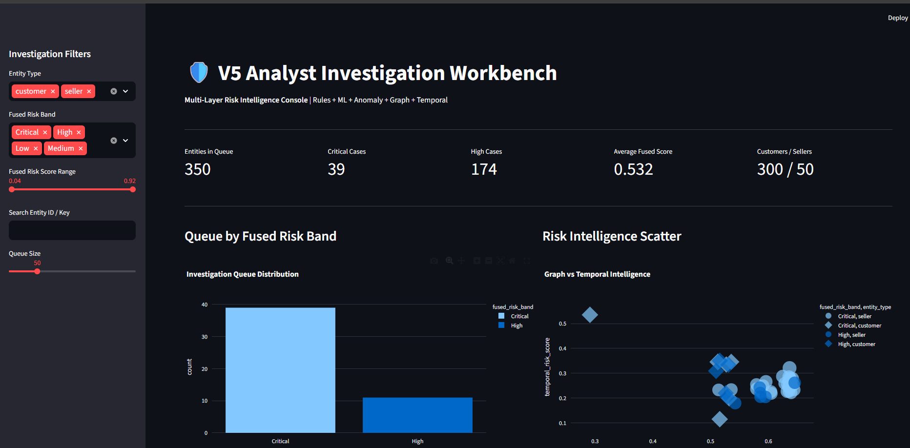
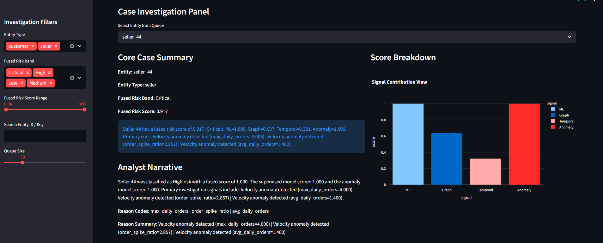
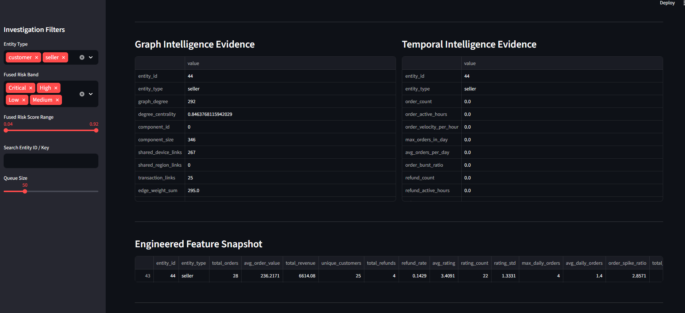
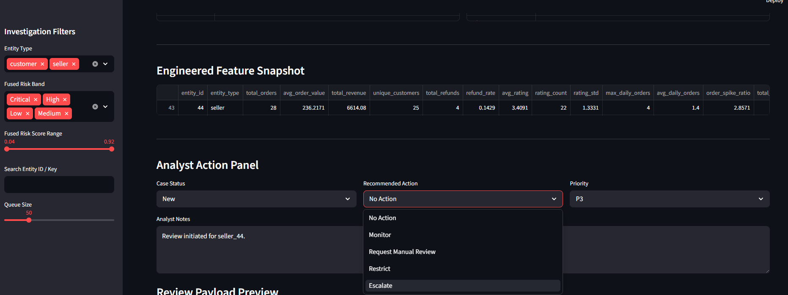

# MRI: Marketplace Risk Intelligence

> Built and tested on synthetic marketplace data. Not a live deployment.
>
> **Live demo:** https://mri-risk-intelligence.streamlit.app/ (may take about 30 s to wake up if idle)

Multi-signal fraud and risk intelligence pipeline for online marketplaces. Rule-based heuristics, supervised ML, unsupervised anomaly detection, graph analysis and temporal burst detection are fused into one calibrated, explainable risk score and surfaced in a Streamlit analyst workbench.

## Architecture

```text
Raw data (customers, sellers, orders, refunds, ratings, logins)   data/raw/*.csv
        |
SQLite hydration + feature engineering
        |
Detection layer
  |- V1  Rule engine           heuristic weak labels
  |- V2  Supervised model      Random Forest classifier
  |- V2  Anomaly model         Isolation Forest
  |- V3  Graph analysis        NetworkX entity-link / shared-device clusters
  '- V4  Temporal analysis     login, order and refund bursts
        |
Risk fusion engine             weighted, calibrated, banded (Critical/High/Medium/Low)
        |
V5  Analyst workbench          Streamlit, per-entity explanations and evidence
        |
V6  Governance                 drift monitoring, pipeline health, model registry
```

### Fusion

```text
Final Risk = 0.40 * ML + 0.25 * Graph + 0.20 * Temporal + 0.15 * Anomaly
```

## Repository layout

```text
src/mri/
  config.py            single source of truth for paths
  pipeline.py          orchestrator (python -m mri.pipeline)
  data/                generate.py (synthetic data), build_db.py (CSV -> SQLite)
  detection/           rules.py, graph.py, temporal.py
  features/            engineering.py
  models/              train.py, score.py, explain.py
  fusion/              fuse.py
  governance/          ops.py (drift, health, registry)
  app/                 workbench.py (Streamlit)
data/raw/              committed synthetic CSVs
docs/                  data_dictionary.md
legacy/                superseded v1/v2 dashboards and v3 fusion, kept for reference
tests/                 end-to-end smoke test
```

`data/marketplace.db`, `artifacts/`, `models/` and `outputs/` are generated by the pipeline and are not committed.

## Quick start

```bash
python -m venv .venv
source .venv/bin/activate        # Windows: .venv\Scripts\activate
pip install -e .
python -m mri.pipeline           # builds the DB, trains, scores, fuses (about 15 s)
streamlit run src/mri/app/workbench.py
```

Regenerate the synthetic dataset (optional): `python -m mri.data.generate`

Run the tests: `pip install -e ".[dev]" && pytest`

## Screenshots

Analyst workbench (`src/mri/app/workbench.py`):

| Investigation queue | Case investigation |
|---|---|
|  |  |
|  |  |

Earlier iterations (v1 command center, v2 hybrid scoring dashboard) are in [`docs/screenshots/`](docs/screenshots/).

## Governance outputs

- `outputs/v6_feature_drift.csv`: feature drift against the stored baseline
- `outputs/v6_pipeline_health.json`: pipeline health report
- `outputs/ops_registry.db`: model and artifact registry with SHA-256 hashes

## Deploy the dashboard

GitHub hosts the code, not the running app. To get a public URL, deploy the workbench on [Streamlit Community Cloud](https://share.streamlit.io): connect this repository, set the main file to `src/mri/app/workbench.py`, and deploy. The app builds its dataset on first launch (about 15 s), so no committed data files are needed.

## Roadmap

- Move ETL from Pandas to Polars for out-of-core processing
- Evaluate XGBoost / LightGBM in place of Random Forest
- Containerise with docker-compose (feature store, inference API, UI)
- Local quantised LLM (Ollama) for human-readable case summaries

## Security notes

- Synthetic data only; no real customer or transaction data.
- Model files are loaded with `joblib`, which uses pickle: only load models you trained yourself.
